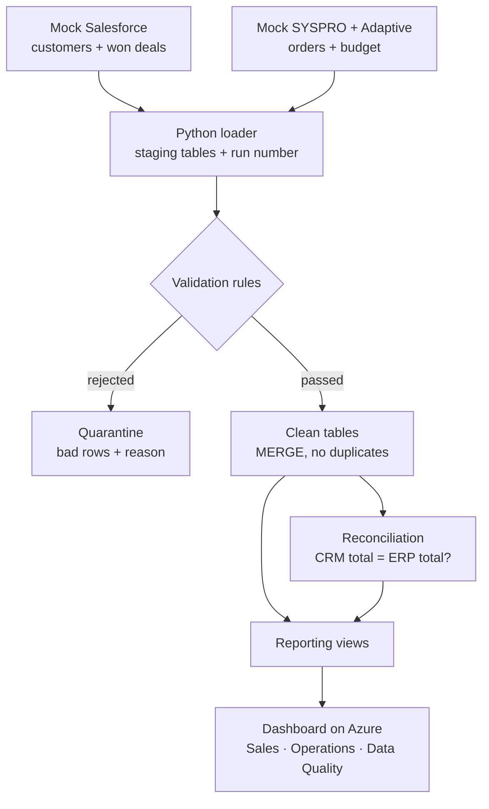

# Innovasea Data Bridge

A small, working version of a Database & Enterprise Systems role: mock
**Salesforce** (CRM), **SYSPRO** (ERP) and **Workday Adaptive** (planning) data
flows into **Azure SQL**, gets validated and reconciled, and feeds one trusted
dashboard for Finance, Operations and leadership.

**Live dashboard:** https://innovasea-databridge-mhaiba.azurewebsites.net
_(free tier: the first load can take a minute while the app and database wake up)_

> All data is synthetic, generated by `pipeline/generate_mock_data.py`.
> No real company, customer or product data is used.

## The rule it follows

**Bad data is stopped and explained, never silently dropped.**

## How it works



1. **Load:** six CSV files land in `stg` staging tables exactly as they arrived, stamped with a run number.
2. **Validate:** a stored procedure checks every row: required fields, valid numbers and dates, known customers and products, no duplicates. Failures go to `etl.Quarantine` with a plain-English reason and the original row.
3. **Merge:** valid rows are merged into the `dbo` system of record on business keys. Re-running changes nothing.
4. **Reconcile:** Salesforce won deals are compared with SYSPRO orders; every gap is listed.
5. **Report:** `rpt` views feed a Streamlit dashboard on Azure App Service.

The whole pipeline runs with one command: `python pipeline/run_pipeline.py`.

## Results

| Check                                       | Result                                                                            |
| ------------------------------------------- | --------------------------------------------------------------------------------- |
| Planted bad rows caught by validation       | **9 of 9** (7 planted + 2 lines whose orders were rejected), 0 false rejections   |
| Idempotency                                 | Full pipeline re-run: **0 rows changed**                                          |
| CRM vs ERP reconciliation                   | **$14,300.00** gap, fully explained by **2** issues; lost deals correctly ignored |
| Legacy report query, refactored and indexed | **~74% fewer** pages read, about **4x faster** (see `docs/performance.md`)        |

## Security

- **Least privilege:** the dashboard connects as `dashboard_user` (read `rpt` views only); the pipeline as `pipeline_user` (staging, run log, ETL procedures only). Admin is for setup only.
- **Data masking:** customer emails are masked for anyone without permission.
- **Secrets** live in `.env` locally (git-ignored) and in App Service settings in Azure, never in code.
- **Encryption** in transit (TLS 1.2+, HTTPS only), and a database firewall allowing only specific IPs and Azure services.

## Tech

Azure SQL Database · T-SQL (stored procedures, MERGE, views, indexes) · Python (pandas, pyodbc) · Streamlit · Azure App Service · Git

## Project layout

| Folder       | Contents                                                                       |
| ------------ | ------------------------------------------------------------------------------ |
| `sql/`       | Schema, validation, merge, reconciliation, views, indexes, security (template) |
| `pipeline/`  | Data generator, one script per pipeline step, and `run_pipeline.py`            |
| `dashboard/` | Streamlit dashboard                                                            |
| `data/`      | Generated CSVs and `planted_issues.md` (the answer key)                        |
| `docs/`      | Runbook, data dictionary, performance results, screenshots                     |

## Run it

```bash
python -m venv .venv && source .venv/bin/activate
pip install -r requirements.txt
# create .env with DB_SERVER, DB_NAME, DB_USER, DB_PASSWORD
python pipeline/generate_mock_data.py
python pipeline/run_pipeline.py
streamlit run dashboard/app.py
```

Run the `sql/` scripts in number order once, to create the database objects
(use `12_security_template.sql` and set your own passwords).

**Mac note:** if Python can't connect with _"OpenSSL library could not be loaded"_, add
`export DYLD_LIBRARY_PATH=/opt/homebrew/opt/openssl@3/lib` to `~/.zprofile`.

## What I learned

- **An index doesn't help a query that can't use it.** `YEAR(OrderDate)` hid the column from the index; the rewrite and the index only worked together.
- **A correct chart can still mislead.** Mixing two years of generated history with current data looked like revenue collapsed, so I added a year filter.
- **Cloud constraints are part of the design.** Region policies and quotas decided where things ran, so I documented the trade-offs instead of working around policy.
- **Plan for things being asleep.** The free database pauses when idle, so connections retry automatically.
- **Check the simple things in order.** A failed login was a password stored with literal quote characters: user exists → role correct → credential matches.

## What I'd do next

- Schedule `run_pipeline.py` nightly (Azure Function or SQL Agent job) with failure alerts
- Managed identity instead of SQL passwords
- App and database in the same region, on tiers that don't sleep
- Power BI on top of the same `rpt` views
- Row-level security, so each region sees only its own customers
